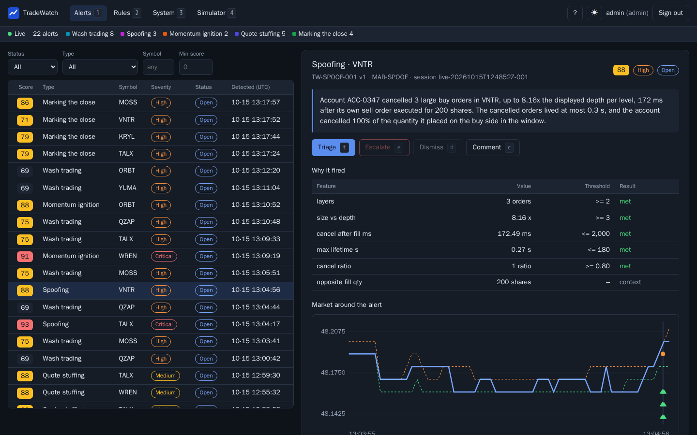
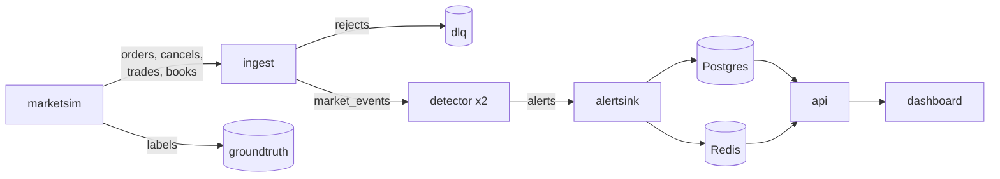

# TradeWatch

Real-time market surveillance on Kafka, written in Go.

TradeWatch runs a simulated exchange, streams its order flow through Kafka
and detects five kinds of market abuse: wash trading, spoofing and
layering, momentum ignition, quote stuffing, and marking the close.
Detection rules are versioned YAML. Every alert carries the orders and
trades behind it, the features that crossed their thresholds and a
plain-language explanation, and analysts work the alerts in a React
dashboard. The simulator labels the abuse it injects, so detection quality
is measured against ground truth.

All market data is simulated.



## Getting started

You need Docker with the Compose plugin and GNU make (on Windows, WSL2).
Everything else runs in containers.

```sh
make up     # build and start the stack
make demo   # inject labelled abuse and print the alerts it raises
```

The dashboard is on http://localhost:3000. Sign in as `analyst`, or as
`admin` to also control the simulator; `make env` generates both passwords
into `.env`. Grafana is on port 3001, Prometheus on 9090 and Jaeger on
16686.

`make demo` triggers a wash-trading ring, a spoofing episode and a
quote-stuffing burst through the API. It waits for each episode's
ground-truth label, then prints the alert that matches it. From
[a run on Kubernetes](docs/results/k8s/README.md):

```text
wash.ring on WREN
  Ground truth  label live-20261015T123524Z-001/0005: 3 accounts ACC-0062,
                ACC-0092, ACC-0003, 18 orders, 12:39:06.493 to 12:40:02.405
  Alert         wash_trading by rule TW-WASH-001 v2 (MAR-WASH), severity high,
                score 75, detected 13.2 s into the episode in simulated time
  Why           Accounts ACC-0003, ACC-0062, ACC-0092, held by 3 different
                beneficial owners, traded WREN with each other in a closed
                cycle of 3 legs within 13.2 s. Every leg looked pre-arranged,
                and the smallest leg was 100% of the largest, so the shares
                went round the circle and back with no net change in
                ownership.
  Dashboard     http://localhost:3000/#/alerts/2924039e22fd235ec9da175bf087ec29
```

Not every episode is detected. The demo injects a missed scenario again on
another symbol, up to three times; in that run the first ring was missed.

## Architecture



The simulator stamps every event with a per-symbol sequence number. Ingest
validates and enriches the raw feeds and releases events in sequence
order, so the detectors see each symbol in exchange order whatever the
fetch timing. Live processing, a replay of a recording and the offline
evaluator therefore raise the same alerts from the same events.

The detectors run as a consumer group and persist no state: a partition's
new owner rebuilds it by replaying from a checkpoint kept in the
offset-commit metadata. Offsets are committed only after outputs are
durable, and alerts have deterministic keys, so a redelivery never becomes
a second alert. Nothing in the pipeline reads the ground-truth labels.

[docs/architecture.md](docs/architecture.md) has the topics, services and
ports, and [docs/adr](docs/adr/README.md) the main design decisions.

## Results

These come from the reports in [docs/results](docs/results), which the make
targets regenerate.

Detection quality, from `make eval`: 25 seeded sessions, 20 with injected
abuse and 5 without ([report](docs/results/eval/README.md)). The baseline
for each type looks only at its most obvious signal.

| Abuse type | Recall | Precision | F1 | Median time to detect | Baseline F1 |
| --- | ---: | ---: | ---: | ---: | ---: |
| Wash trading | 0.93 | 0.92 | 0.92 | 0 s | 0.22 |
| Spoofing / layering | 0.80 | 1.00 | 0.89 | 12 s | 0.02 |
| Momentum ignition | 0.67 | 0.99 | 0.80 | 46 s | 0.56 |
| Quote stuffing | 0.93 | 1.00 | 0.96 | 0 s | 0.96 |
| Marking the close | 0.68 | 0.91 | 0.78 | 25 s | 0.18 |

The baseline finds more spoofing and momentum episodes, but at a precision
of 0.01 and 0.43. It ties on quote stuffing because no normal participant
in the simulator sends 100 messages a second.
[docs/detectors.md](docs/detectors.md#evaluation) goes through each type.

Throughput, from `make bench` on one laptop (AMD Ryzen 7 4800H, Docker
Desktop on WSL2) running the whole stack and the load generator
([report](docs/results/bench/README.md)): the pipeline sustained 80,001
events per second. At that rate an alert reached Postgres 52.3 ms after
the event that triggered it at the median, and 177 ms at p99. At 100,000
events per second ingest's single processing loop fell behind
([docs/performance.md](docs/performance.md)).

Fault tolerance, from `make chaos`: detectors, ingest and the alert sink
were killed, restarted and rescaled mid-stream, and old records were
published again ([report](docs/results/chaos/README.md)). Postgres ended up
with exactly the 477 alerts an offline replay of the session produces,
none lost and none duplicated.

## Development

| Command | |
| --- | --- |
| `make test` | Go unit, race and integration tests, and the dashboard tests |
| `make lint` | gofmt, go vet, staticcheck, alerting-rule tests and Kubernetes schema checks |
| `make eval` | Detection quality report |
| `make bench` | Load test at rising event rates |
| `make chaos` | Fault injection while the pipeline runs (changes data) |
| `make replay` | Rerun detection over a recorded session |
| `make web-e2e` | Browser test against the running dashboard (changes data) |
| `make k8s-smoke` | Deploy to a throwaway k3s cluster and run the demo there |
| `make help` | Everything else |

The Kubernetes manifests are in [deploy/k8s](deploy/k8s/README.md).

## Limitations

- One simulated venue with eight symbols. The order book handles limit
  (day, IOC, FOK), market, cancel and replace orders with a continuous
  closing phase: no auctions, hidden or iceberg orders, trading halts,
  other venues or derivatives.
- The detectors were tuned against TradeWatch's own injector, with perfect
  labels. The evaluation shows how well they find these patterns in this
  market, not how they would do on a real one.
- The MAR taxonomy codes on rules are an indicative mapping, not a legal
  classification.
- The benchmark ran on one machine with one Kafka broker.
- Authentication is two built-in users with HS256 JWTs. There is no TLS
  and no user management.
- Replaying a recording is a CLI (`make replay`); the API has no replay
  controls.
- The Kubernetes manifests run single-node Kafka and Postgres without TLS,
  backups or network policies.

## Documentation

- [Architecture](docs/architecture.md)
- [Matching engine](docs/matching-engine.md)
- [Market simulator](docs/simulator.md)
- [Injected abuse and ground truth](docs/manipulation.md)
- [Ingest](docs/ingest.md)
- [Detectors and rules](docs/detectors.md)
- [Storage and the alert sink](docs/storage.md)
- [Dashboard](docs/dashboard.md)
- [API](docs/api.md)
- [Delivery semantics](docs/delivery-semantics.md)
- [Observability](docs/observability.md)
- [Performance](docs/performance.md)
- [Kubernetes](deploy/k8s/README.md)
- [Design decisions](docs/adr/README.md)
