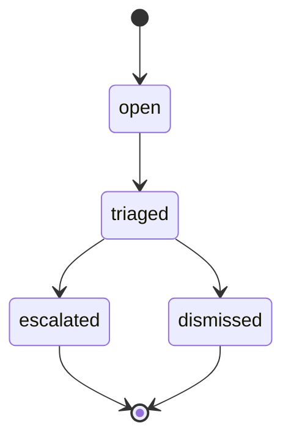

# API

`api` serves TradeWatch over HTTP. It covers:

- the alerts, with their full evidence, workflow and audit trail;
- the rule versions detectors have loaded;
- a live view and a stream of server-sent events;
- for admins, an authenticated proxy to the simulator's controls.

The contract is [`internal/api/openapi.yaml`](../internal/api/openapi.yaml).
The running API also serves it at `GET /api/v1/openapi.yaml`. The
integration tests validate every response they receive against it. They
check both the body schema and that the status code is documented for the
operation. A unit test checks that every route the server registers is in
the document and every documented operation is routed.

In the compose stack the API listens on `http://localhost:8080` and is bound
to the loopback interface only.

## Authentication

There are two accounts, `analyst` and `admin`.

- **Passwords.** `make env` generates random passwords into `.env`, which is
  git-ignored, as `TW_API_ANALYST_PASSWORD` and `TW_API_ADMIN_PASSWORD`.
  Nothing secret is in the repository. The API keeps only bcrypt hashes in
  memory.
- **Tokens.** `POST /api/v1/auth/login` returns an access token. It is an
  HS256 JWT signed with `TW_API_JWT_SECRET` (also generated into `.env`) and
  valid for `TW_API_TOKEN_TTL` (1 hour). Send it as
  `Authorization: Bearer <token>`.
- **Verification is strict:**
  - the algorithm is pinned to HS256, so `none` and other algorithms are
    refused;
  - issuer, audience and expiry are required;
  - a token's user and role must still exist in the configuration, so
    removing a user or changing a role revokes their tokens at the next
    restart.
- **Lockout.** Five failed logins for a username within 15 minutes lock that
  username until the oldest failure is 15 minutes old. Until then, logins
  get `429` with `Retry-After`. A login for an unknown user takes as long as
  one with a wrong password.
- **Roles.** Analysts read and work alerts. Admins can also control the
  simulator.

```sh
PW=$(grep '^TW_API_ANALYST_PASSWORD=' .env | cut -d= -f2-)
TOKEN=$(curl -s -X POST localhost:8080/api/v1/auth/login -H 'Content-Type: application/json' \
  -d "{\"username\":\"analyst\",\"password\":\"$PW\"}" | jq -r .access_token)
curl -s "localhost:8080/api/v1/alerts?abuse_type=spoofing&limit=5" -H "Authorization: Bearer $TOKEN" | jq
```

## Endpoints

| Method and path | Role | Purpose |
| --- | --- | --- |
| `POST /api/v1/auth/login` | public | Exchange a username and password for a token |
| `GET /api/v1/me` | analyst | The token's user, role and expiry |
| `GET /api/v1/alerts` | analyst | Alerts, newest detection first. Filters: `status`, `abuse_type`, `symbol`, `account`, `session`, `min_score`. Paged with `limit` and `cursor`. |
| `GET /api/v1/alerts/{key}` | analyst | One alert with its features and thresholds, the orders and trades involved, the evidence timeline and the price chart |
| `GET /api/v1/alerts/{key}/audit` | analyst | Everything that happened to the alert: raised, status changes and comments, with who and when |
| `POST /api/v1/alerts/{key}/transitions` | analyst | Move the alert through the workflow |
| `POST /api/v1/alerts/{key}/comments` | analyst | Add a note to the audit trail |
| `GET /api/v1/stats` | analyst | Totals by status, abuse type and symbol (from Postgres) |
| `GET /api/v1/live` | analyst | Running totals and the most recently stored alerts (from Redis) |
| `GET /api/v1/system` | analyst | Throughput, consumer lag, latency percentiles, dead letters and service health (from Prometheus) |
| `GET /api/v1/stream` | analyst | Server-sent events as alerts are raised and updated |
| `GET /api/v1/rules` | analyst | The rule set most recently loaded by a detector |
| `GET /api/v1/rules/{id}` | analyst | Every version of a rule that a detector has loaded, with its YAML source |
| `GET /api/v1/sim/status`, `POST /api/v1/sim/start`, `POST /api/v1/sim/stop`, `PUT /api/v1/sim/pace`, `GET` and `PUT /api/v1/sim/injection`, `GET` and `POST /api/v1/sim/scenarios` | admin | The simulator's controls ([simulator.md](simulator.md), [manipulation.md](manipulation.md)) |
| `GET /api/v1/openapi.yaml` | public | The OpenAPI document |

**Formats.**
- **Times** are RFC 3339 in UTC. Window and detection times are simulated
  market time; `first_seen_at` and `status_changed_at` are wall-clock times.
- **Prices** are integers in units of 1/10,000 of the quote currency.
- **Errors** are RFC 7807 problem details (`application/problem+json`).

## Workflow

Every alert starts `open`:



- **Notes.** Escalating or dismissing requires a note giving the reason.
  Without one the request gets `422`.
- **Disallowed moves** get `409`, for example escalating an open alert, or
  any move out of a final status.
- **Concurrent changes** to one alert are serialized. If two analysts triage
  the same alert at once, exactly one succeeds and the other gets `409`.
- **Audit trail.** Every change and every comment is written in the same
  transaction as the status, with the analyst's name.
- **Live feed.** A status change is also published, as an `alert.updated`
  event.

## Live view and event stream

`GET /api/v1/live` reads the views the alert sink keeps in Redis: totals by
abuse type and symbol, and the most recently stored alerts. If Redis is
unavailable it answers `503`; the Postgres-backed endpoints keep working.

`GET /api/v1/stream` is a `text/event-stream`. Here are two events from a
compose-stack run, shortened:

```text
event: alert.raised
data: {"key":"526facc6…","symbol":"WREN","abuse_type":"quote_stuffing","score":83.3, …}

event: alert.updated
data: {"key":"526facc6…","status":"triaged", …}
```

The `data` of each event is the same alert summary the list endpoint
returns.

- **Keep-alive.** A comment line every 15 seconds keeps idle connections
  open through proxies.
- **Authentication.** Send the token in the `Authorization` header. Browser
  `EventSource` cannot set headers, so use a fetch-based client.
- **Fan-out.** Each API instance holds one Redis subscription and fans it
  out to its clients.
- **Slow clients.** A client more than 64 events behind is disconnected
  rather than allowed to hold up the others.
- **Missed events.** Events are best-effort. After reconnecting, reload from
  `GET /api/v1/alerts`.

## System status

`GET /api/v1/system` summarizes the pipeline for the dashboard's System
page. It runs a fixed set of PromQL queries against Prometheus
(`TW_API_PROMETHEUS_URL`) and returns:

- **Throughput:** events per second published, released by ingest and
  processed by the detectors, over the last minute, and alerts stored per
  minute over the last five.
- **Consumer lag** of ingest, the detectors and the alert sink, in records.
- **Latency percentiles** (p50, p95, p99): from publication to a detector
  (last five minutes), the detectors' time per event, and from publication
  to the stored alert (last fifteen).
- **Dead letters** in the last hour, by stage and reason.
- **Services:** the instances Prometheus found and how many are up.
- **History:** the last 30 minutes in 30-second steps, for sparklines.

A value is `null` when Prometheus has no data for it, for example a
latency quantile before the first alert. The result is kept for five
seconds, and concurrent requests share one collection, so any number of open
dashboards costs Prometheus one set of queries every five seconds. Without
a Prometheus URL, or when a query fails, the endpoint answers `503`. The
cause is logged but not returned.

## Simulator control

marketsim's control endpoints listen only on the internal network and have
no authentication of their own. The API forwards `/api/v1/sim/*` to them for
admins, without the caller's token or cookies, and logs every call with the
admin's name. If marketsim cannot be reached, the API answers `502`.

## Hardening

- **Responses** carry `Cache-Control: no-store` and
  `X-Content-Type-Options: nosniff`.
- **Request bodies** are limited to 16 KiB, and unknown JSON fields are
  rejected.
- **Timeouts.** Requests other than the event stream are cut off after 30
  seconds, and headers must arrive within 5.
- **Errors.** A 500 never includes internal error text; the detail is
  logged.
- **CORS.** None: the dashboard is meant to be served from the same origin.

## Configuration

| Variable | Default | Meaning |
| --- | --- | --- |
| `TW_API_ADDR` | `:8080` | Public listener |
| `TW_HTTP_ADDR` | `:8094` | Admin server (metrics, health) |
| `TW_POSTGRES_URL` | required | Postgres connection URL |
| `TW_REDIS_ADDR` | `localhost:16379` | Redis address |
| `TW_REDIS_PREFIX` | `tw:` | Prefix of the live-view keys and channel |
| `TW_API_SIM_URL` | `http://localhost:8090` | marketsim's admin server |
| `TW_API_PROMETHEUS_URL` | none | Prometheus, for `GET /api/v1/system` |
| `TW_API_GRAFANA_URL` | none | Grafana as a browser reaches it; the System page links to its pipeline dashboard |
| `TW_API_JWT_SECRET` | required, at least 32 bytes | Token signing secret |
| `TW_API_TOKEN_TTL` | 1h | Token lifetime |
| `TW_API_ANALYST_PASSWORD`, `TW_API_ADMIN_PASSWORD` | required, at least 12 bytes | Account passwords |

## Metrics

| Metric | Meaning |
| --- | --- |
| `tradewatch_api_requests_total{route,method,code}` | Requests |
| `tradewatch_api_request_duration_seconds{route}` | Latency (the event stream excluded) |
| `tradewatch_api_logins_total{result}` | Logins: `ok`, `failed`, `locked` |
| `tradewatch_api_stream_clients` | Connected event-stream clients |

## Tests

| Test | What it checks |
| --- | --- |
| `TestSpecMatchesTheRoutes` | The OpenAPI document is valid, documents exactly the routed operations, and marks only login and the document itself as public |
| `TestAuthenticationAndRoles` | Login, wrong passwords, missing and invalid tokens, the analyst/admin split, lockout with `Retry-After`, and the simulator proxy (method, path and body forwarded, token not forwarded) |
| `TestAlertWorkflowOverHTTP` | Paging and filters, evidence detail, every workflow error (`409`, `422`, `400`), comments, the audit trail, stats, the live view, rules and rule history |
| `TestStreamDeliversRaisedAndUpdatedAlerts` | A raised alert and a status change reach a connected event-stream client |
| `TestUnreachableSimulatorIsABadGateway` | The proxy answers `502` when marketsim is down |
| `TestSystemSummarizesThePipelineFromPrometheus` and the other `TestSystem…` tests | Against a fake Prometheus: every figure, nulls for missing data, rounded and sorted dead-letter counts, services, history alignment and the five-second cache. Without Prometheus, or when it fails, the answer is a `503` that does not reveal the cause. |
| `internal/auth` tests | Tampered payloads, `alg: none`, HS512, a wrong secret, wrong audience or issuer, a missing or past expiry, a token issued in the future, unknown users and changed roles are all refused |
