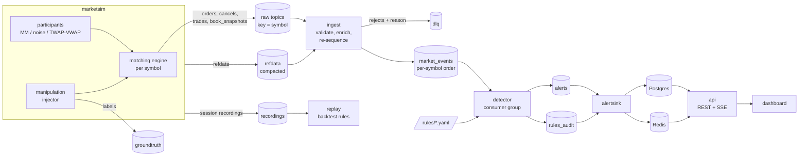

# Architecture

TradeWatch is a market-surveillance pipeline. A simulated exchange produces
order, cancel, trade and book events with labelled abusive behaviour mixed
in. A normalization stage restores per-symbol order and enriches events with
reference data. Stateful detectors raise explainable alerts. Analysts work
the alerts in a web dashboard, and an evaluator scores detection quality
against the ground-truth labels.

All market data is simulated. Nothing here is connected to a real venue.

## Data flow

Two offline tools reuse the detection engine without Kafka. The evaluator
simulates seeded sessions in-process and scores the rules against their
ground truth ([detectors.md](detectors.md#evaluation)). The replay tool
reruns detection over marketsim's recordings, which carry their reference
data and labels.

## Services

| Service | Role | Ports (compose) |
| --- | --- | --- |
| `marketsim` | Simulated exchange: matching engines, participants, injected abuse, ground truth | admin `:8090` (internal) |
| `ingest` | Validates, enriches and re-sequences the raw feeds into `market_events` | admin `:8091` (internal) |
| `detector` (2 replicas) | Runs the rule-driven detectors and publishes alerts | admin `:8092` (internal) |
| `migrate` | One-shot: applies the Postgres migrations | — |
| `alertsink` | Stores alerts and rule sets in Postgres and keeps the Redis live views | admin `:8093` (internal) |
| `api` | REST and server-sent events with JWT authentication; proxies simulator control for admins | `localhost:8080`, admin `:8094` (internal) |
| `web` | The dashboard, served by nginx, which proxies `/api` to the API | `localhost:3000` |
| `prometheus` | Scrapes every admin port and evaluates the alerting rules ([observability.md](observability.md)) | `localhost:9090` |
| `grafana` | Provisioned dashboards over Prometheus | `localhost:3001` |

Each admin server exposes `/metrics`, `/healthz`, `/readyz` and the Go
profiler under `/debug/pprof/`. Admin ports stay on the internal network:
compose does not publish them.

## Topics

All symbol-keyed topics share one partition count (`TW_KAFKA_PARTITIONS`,
default 6). See [ADR-0003](adr/0003-partitioning-and-ordering.md).

| Topic | Key | Value | Producer | Consumers | Retention |
| --- | --- | --- | --- | --- | --- |
| `orders` | symbol | `OrderEvent` | marketsim | ingest | 1 day |
| `cancels` | symbol | `CancelEvent` | marketsim | ingest | 1 day |
| `trades` | symbol | `TradeEvent` | marketsim | ingest | 1 day |
| `book_snapshots` | symbol | `BookSnapshot` | marketsim | ingest | 1 day |
| `market_events` | symbol | `MarketEvent` | ingest | detector | 1 day |
| `refdata` | account / symbol / session | `RefDataRecord` | marketsim | ingest | compacted |
| `groundtruth` | session | `GroundTruthLabel` | marketsim | none yet (the evaluator and replay take labels from simulations and recordings) | 7 days |
| `alerts` | alert key | `Alert` | detector | alertsink | 7 days |
| `dlq` | source key | `DeadLetter` | ingest | operators | 7 days |
| `rules_audit` | rule-set digest | `RuleSetSnapshot` | detector | alertsink | compacted |

Schemas live in [`proto/tradewatch/v1`](../proto/tradewatch/v1). Evolution
rules are in [ADR-0002](adr/0002-event-schema-and-evolution.md).

## Ordering

The matching engine stamps every event with a gap-free per-(session, symbol)
sequence number, whichever feed the event is published on. Ingest owns
partition *p* of all four raw topics (Range assignment over co-partitioned
topics) and releases events to `market_events` strictly in sequence order.
Detectors therefore see each symbol's events in exchange order. Detection
results do not depend on fetch timing, which makes live processing, replay
and evaluation produce the same alerts for the same input.

## Repository layout

| Path | Contents |
| --- | --- |
| `cmd/` | One `main` package per service and CLI |
| `internal/` | Shared packages (engine, events, detection, rules, storage, Kafka, metrics, auth) |
| `proto/` | Protobuf schemas |
| `rules/` | Versioned detection rules (YAML) |
| `web/` | React dashboard |
| `deploy/` | Compose add-ons and Kubernetes manifests |
| `docs/` | Architecture, ADRs, detector documentation, measured results |
| `scripts/` | Helper scripts used by the Makefile |
