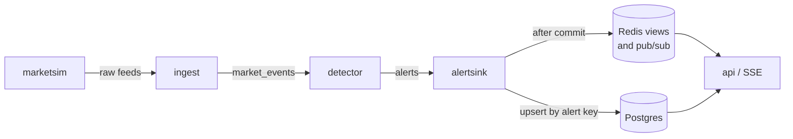

# Delivery semantics

This document follows an event from the simulated exchange to an alert on
an analyst's screen. For each hop it states what is guaranteed, what can go
wrong, and what absorbs the failure. The short version:

- Every hop delivers **at least once**.
- Every hop downstream of the exchange **deduplicates on a deterministic
  identity**:
  - market events on (session, symbol, sequence number);
  - alerts on their alert key.

So a crash can cause reprocessing, but it cannot create a second alert row or
lose one. The Redis views and the event stream are derived conveniences.
Postgres is the system of record.

## The hops

| Hop | Guarantee | Identity used to deduplicate | Where it is described |
| --- | --- | --- | --- |
| marketsim → raw topics | Each record is acknowledged by all in-sync replicas. franz-go's idempotent producer removes duplicates caused by its own retries. | — | [ADR-0001](adr/0001-kafka-client.md) |
| raw topics → ingest → `market_events` | At least once, in per-symbol sequence order. No event is skipped without a gap marker. | (session, symbol, seq) | [ingest.md](ingest.md), [ADR-0004](adr/0004-checkpoints-in-commit-metadata.md) |
| `market_events` → detector → `alerts` | At least once. A handover rebuilds state by replay and does not produce alerts before the previous owner's frontier again. | The alert key: a hash of rule, session, symbol, accounts and anchor event | [detectors.md](detectors.md), [ADR-0005](adr/0005-detector-state-by-replay.md) |
| `alerts` → alertsink → Postgres | At least once, with an idempotent upsert, so each alert is stored once | Primary key `alert_key` | [ADR-0006](adr/0006-idempotent-alert-sink.md) |
| Postgres → Redis views | Updated only for alerts stored for the first time, after the transaction commits. Rebuilt from Postgres whenever a sink starts. | — (derived) | `internal/live` |
| Redis pub/sub → SSE clients | At most once: a client that is disconnected misses events and catches up from the REST endpoints | Alert key in each event | [api.md](api.md) |

## Failure by failure

| Failure | Effect | What absorbs it |
| --- | --- | --- |
| A producer retry after a lost acknowledgement | Would duplicate a record | The idempotent producer (broker-side sequence numbers) |
| ingest crashes after publishing, before committing | Events since the last commit are published again | Identical copies with the same (session, symbol, seq). The detector drops sequence numbers it has already processed. |
| A raw record is corrupt | Rejected | Dead-lettered with a reason. A gap marker keeps the sequence contiguous. |
| A detector is rebalanced or stopped gracefully | Its partitions move | The new owner replays from the checkpoint's low-water offset and produces nothing before the frontier. Integration tests check that no alert is lost or duplicated. |
| A detector crashes between a flush and the next commit | Alerts since the last commit are produced again | Same alert keys. The sink increments `deliveries` instead of adding rows. |
| A detector is stopped while it is still rebuilding | — | It does not commit until its replay reaches the previous frontier, so the previous checkpoint stays in force |
| alertsink is stopped gracefully during a batch | — | It finishes the batch and commits its offsets, for up to 10 s after the stop, so a restart redelivers nothing |
| alertsink crashes after the database commit, before committing offsets | The batch is redelivered | The upsert finds every key and changes only `deliveries` and `last_seen_at`. The Redis views missed nothing, because Redis is updated only on first insert. |
| alertsink crashes after the database commit, before updating Redis | The live views miss those alerts | The next sink rebuilds the views from Postgres when it starts |
| Postgres is unavailable | The sink stops making progress and commits nothing | It retries with exponential backoff (up to 30 s between attempts, ten attempts per batch), then exits so the orchestrator restarts it. Kafka keeps the records. |
| Postgres rejects one alert, for example text containing a NUL byte | The batch transaction fails | The batch is retried alert by alert. Only the rejected alert goes to the dead-letter topic, with reason `store_rejected`. |
| Redis is unavailable | Live counts, the recent list and the event stream pause | Postgres and the REST endpoints keep working. The sink marks the views stale and rebuilds them once Redis is back. |
| Redis evicts a key under memory pressure | A live count or summary is lost | The views are derived: the next rebuild restores them |
| Two analysts change one alert at once | One change could overwrite the other | `SELECT … FOR UPDATE` serializes the changes. The later one sees the new status and gets 409 if the workflow no longer allows it. |

## What is verified

| Property | Test |
| --- | --- |
| A sequence survives ingest restarts without loss, reordering or invented gaps | `TestIngestResumesFromItsCheckpoint` |
| The live pipeline produces exactly the in-process alerts | `TestLivePipelineProducesTheInProcessAlerts` |
| Detector handovers and rebalances lose and duplicate nothing | `TestDetectorHandoversLoseAndDuplicateNothing`, `TestStopDuringReplayKeepsThePreviousCheckpoint` |
| Restoring from a checkpoint reproduces every alert exactly | `TestRestartFromCheckpointReproducesEveryAlert` |
| Duplicate deliveries, a sink restart, a garbage record and a record Postgres rejects leave exactly one row per alert. Live counts are exact and both bad records are dead-lettered. | `TestSinkStoresEachAlertOnceAcrossDuplicatesAndRestarts` |
| Concurrent deliveries of one alert store one row and raise it once | `TestConcurrentDeliveriesOfOneAlertStoreOneRow` |
| Concurrent status changes are serialized | `TestConcurrentTransitionsAreSerialized` |
| A rebuild restores the views after a lost counter and a sink that died before updating Redis | `TestRaisedUpdatedAndRebuild` |
| On the running stack, no alert is lost or duplicated when consumers are killed, restarted and rescaled mid-stream and old records are re-published | `make chaos` ([results/chaos](results/chaos/README.md)) |

### The chaos test

The integration tests stop services gracefully. `make chaos` breaks the
whole compose stack mid-stream, while one recorded session (795,425
events in the latest run) streams through it:

- **Process kills:** it kills one detector with SIGKILL, then both
  detectors at once, then ingest and the alert sink together.
- **Graceful restarts and rebalances:** it restarts ingest and the sink
  gracefully, and scales the detectors from two to three and back, forcing
  rebalances.
- **Duplicates:** it re-publishes exact copies of the last 5,000 records of
  every partition of the raw feeds and `market_events`, and of every alert
  of the session.

When the session ends and every consumer group has committed up to the
end of its input, it replays the session's recording offline. It then
requires Postgres to hold exactly the alerts the replay produces, with the
same content, each raised once.

The latest run passed. The replay produced 477 alerts, and Postgres held
those 477 and nothing else. The alerts topic carried 549 deliveries of
them: the 70 re-published copies and two alerts a killed detector had
produced but not committed. The alert key absorbed every one.

**Recovery cost.** The run also shows what a crash costs. A detector that
takes over a partition re-reads it from its checkpoint's low-water offset,
the earliest event any open state still needs. A session that stops
without closing keeps its state open until it has been idle for
`TW_DETECTOR_IDLE_AFTER` (10 minutes).

The run started right after a 100,000-events/s benchmark, whose abandoned
session still held the low-water offset back. Each takeover therefore
re-read millions of records, and the detectors dropped 35 million of
them as already processed. Correctness did not depend on that, but
recovery time did. Directly after a high-rate run, a crash costs a replay
proportional to everything published since.

## Not covered

- **Kafka transactions** are not used, so `market_events` and `alerts` can
  contain duplicate records after a crash. Everything that reads them
  deduplicates, as described above, and the duplicates stay visible: the
  `deliveries` column, and `tradewatch_alertsink_alert_duplicates_total`.
- **The live views** under-count after a sink crash until the restarted sink
  has rebuilt them.
- **The event stream** is best-effort, so a client should reload from
  `GET /api/v1/alerts` after reconnecting.
- **One alertsink instance** is the supported deployment. Several instances
  would still store every alert exactly once, but a rebuild running in one
  could race increments made by another.
