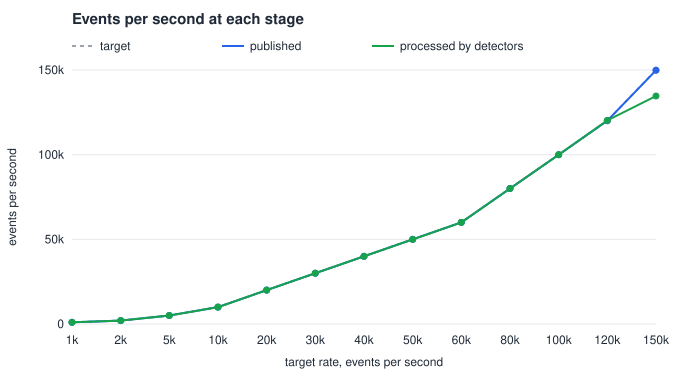
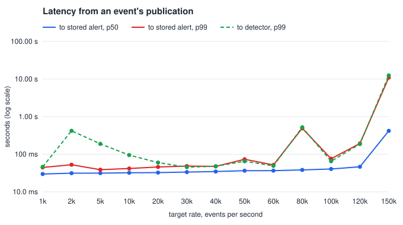
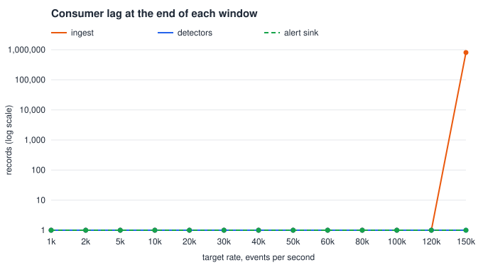

# Pipeline benchmark

Generated by `make bench` from 2026-10-30 15:41 to 15:58 UTC, at commit `e55dee4`. All market data is simulated. These numbers describe this pipeline on the machine below, which also ran the load generator, Kafka, Postgres, Redis and the monitoring stack.

**Sustained throughput: 120,042 events per second**, published by marketsim and kept up with at the 120k step. That is the highest rate at which the detectors processed at least 98% of what was published, and neither ingest nor the detectors ended the window more than one second of traffic behind. At that rate, an alert was stored 46.4 ms after the event that triggered it at the median and 193 ms at the 99th percentile (4,399 alerts).

At 150,000 events per second the pipeline fell behind. Of 149,807 events per second published, ingest released 134,709 and the detectors processed 134,619; at the end of the window ingest was 810,068 records behind and the detectors 0.

## Throughput and lag

| Target, events/s | Published | Released by ingest | Processed by detectors | Ingest lag, end / max | Detector lag, end / max | Verdict |
| ---: | ---: | ---: | ---: | ---: | ---: | --- |
| 1,000 | 1,000 | 1,000 | 1,000 | 0 / 0 | 0 / 0 | sustained |
| 2,000 | 2,000 | 2,000 | 2,000 | 0 / 0 | 0 / 0 | sustained |
| 5,000 | 5,000 | 4,999 | 5,000 | 0 / 0 | 0 / 0 | sustained |
| 10,000 | 10,000 | 10,001 | 10,000 | 0 / 0 | 0 / 0 | sustained |
| 20,000 | 20,000 | 20,001 | 20,011 | 0 / 0 | 0 / 0 | sustained |
| 30,000 | 29,999 | 29,999 | 29,999 | 0 / 0 | 0 / 0 | sustained |
| 40,000 | 40,000 | 40,001 | 40,002 | 0 / 0 | 0 / 0 | sustained |
| 50,000 | 50,002 | 50,001 | 49,988 | 0 / 0 | 0 / 0 | sustained |
| 60,000 | 60,000 | 59,996 | 59,998 | 0 / 0 | 0 / 0 | sustained |
| 80,000 | 80,002 | 79,999 | 79,992 | 0 / 0 | 0 / 0 | sustained |
| 100,000 | 100,001 | 99,998 | 100,000 | 0 / 0 | 0 / 0 | sustained |
| 120,000 | 120,042 | 120,180 | 120,210 | 0 / 126 | 0 / 0 | sustained |
| 150,000 | 149,807 | 134,709 | 134,619 | 810,068 / 810,068 | 0 / 1,110 | fell behind |

## Latency

| Target, events/s | Alerts stored | Event to stored alert: p50 | p95 | p99 | max | Event to detector: p50 | p95 | p99 |
| ---: | ---: | ---: | ---: | ---: | ---: | ---: | ---: | ---: |
| 1,000 | 40 | 29.8 ms | 38.5 ms | 44.5 ms | 44.5 ms | 19.0 ms | 29.1 ms | 46.2 ms |
| 2,000 | 73 | 31.4 ms | 37.4 ms | 52.6 ms | 52.6 ms | 19.3 ms | 29.3 ms | 420 ms |
| 5,000 | 197 | 31.5 ms | 37.4 ms | 38.8 ms | 39.9 ms | 19.6 ms | 29.3 ms | 189 ms |
| 10,000 | 353 | 32.2 ms | 38.5 ms | 41.7 ms | 281 ms | 20.2 ms | 29.5 ms | 95.2 ms |
| 20,000 | 728 | 32.5 ms | 38.5 ms | 45.8 ms | 141 ms | 21.1 ms | 29.5 ms | 59.9 ms |
| 30,000 | 1,086 | 33.6 ms | 39.5 ms | 48.4 ms | 86.3 ms | 22.4 ms | 29.6 ms | 45.4 ms |
| 40,000 | 1,443 | 34.7 ms | 41.7 ms | 47.6 ms | 85.4 ms | 23.5 ms | 29.9 ms | 47.9 ms |
| 50,000 | 1,822 | 36.4 ms | 46.7 ms | 73.6 ms | 114 ms | 24.8 ms | 44.1 ms | 65.1 ms |
| 60,000 | 2,198 | 36.6 ms | 44.2 ms | 51.9 ms | 108 ms | 24.8 ms | 40.2 ms | 49.1 ms |
| 80,000 | 2,871 | 38.3 ms | 82.7 ms | 491 ms | 1.09 s | 26.1 ms | 74.9 ms | 520 ms |
| 100,000 | 3,531 | 40.5 ms | 55.2 ms | 75.9 ms | 219 ms | 28.6 ms | 48.6 ms | 65.1 ms |
| 120,000 | 4,399 | 46.4 ms | 138 ms | 193 ms | 243 ms | 39.6 ms | 130 ms | 187 ms |
| 150,000 | 4,821 | 418 ms | 8.94 s | 10.91 s | 12.77 s | 430 ms | 8.18 s | 12.46 s |

## Resources

CPU in cores and resident memory in MiB, each summed over a service's instances (2 detectors).

| Target, events/s | CPU marketsim | CPU ingest | CPU detector | CPU alertsink | CPU api | MiB ingest | MiB detector | MiB alertsink |
| ---: | ---: | ---: | ---: | ---: | ---: | ---: | ---: | ---: |
| 1,000 | 0.17 | 0.19 | 0.14 | 0.01 | 0.00 | 26 | 88 | 35 |
| 2,000 | 0.20 | 0.22 | 0.17 | 0.01 | 0.00 | 27 | 95 | 35 |
| 5,000 | 0.29 | 0.31 | 0.27 | 0.02 | 0.00 | 28 | 93 | 36 |
| 10,000 | 0.35 | 0.41 | 0.35 | 0.02 | 0.01 | 30 | 95 | 34 |
| 20,000 | 0.43 | 0.52 | 0.46 | 0.04 | 0.01 | 30 | 96 | 34 |
| 30,000 | 0.51 | 0.63 | 0.60 | 0.06 | 0.01 | 34 | 97 | 34 |
| 40,000 | 0.60 | 0.77 | 0.76 | 0.08 | 0.01 | 33 | 97 | 34 |
| 50,000 | 0.74 | 0.94 | 0.97 | 0.11 | 0.02 | 34 | 93 | 33 |
| 60,000 | 0.76 | 0.96 | 1.03 | 0.12 | 0.02 | 35 | 92 | 33 |
| 80,000 | 0.95 | 1.12 | 1.32 | 0.16 | 0.03 | 44 | 95 | 33 |
| 100,000 | 1.08 | 1.33 | 1.56 | 0.19 | 0.03 | 41 | 96 | 34 |
| 120,000 | 1.29 | 1.58 | 1.90 | 0.23 | 0.03 | 44 | 94 | 34 |
| 150,000 | 1.58 | 1.58 | 1.96 | 0.24 | 0.04 | 192 | 117 | 34 |

## Setup

- **Machine:** AMD Ryzen 7 4800H with Radeon Graphics; 16 logical CPUs and 15.3 GiB of memory visible to Docker; kernel 6.18.40.1-microsoft-standard-WSL2; Docker 29.5.3 on Docker Desktop (containerized); go1.26.9.
- **Stack:** the compose stack as `make up` starts it: one Kafka broker, 2 detector instances over 6 `market_events` partitions, one ingest and one alert sink, Postgres, Redis, Prometheus, Grafana and Jaeger. `deploy/compose/bench.yml` switches marketsim to publish at a fixed rate in one long session (`bench-20261030T154121Z-001`, 8 symbols) with recordings off, so that the load generator spends its CPU on publishing. Abuse is injected at these rates, per symbol per simulated hour: marking the close 0.25, momentum ignition 4, quote stuffing 6, spoofing 6, wash trading 6.
- **Method:** each rate runs 20 s before a 60 s measurement window. Every service instance is scraped at both ends of the window and every 2 s within it.

## Definitions

- **Published, released, processed:** the increase of `tradewatch_marketsim_events_published_total`, `tradewatch_ingest_events_released_total` and `tradewatch_detector_events_total` over the window, divided by its length.
- **Event to stored alert** is exact. For every alert of the session stored in the window, it is the time Postgres inserted the alert (`first_seen_at`, its transaction's start) minus the wall-clock time marketsim published the event that triggered the alert. Quantiles use the nearest-rank method, so with fewer than 100 alerts the p99 is the maximum. All containers read the same host clock.
- **Event to detector** comes from the detectors' `event_latency_seconds` histograms over the window, interpolated within buckets as Prometheus's `histogram_quantile` does. The bucket bounds are at most 1.5 times apart.
- **Lag:** the services' consumer-lag gauges, in records, summed over instances: `end` is the last sample of the window.
- **Kept up:** the detectors processed at least 98% of what marketsim published, and neither ingest nor the detectors ended the window more than one second of traffic (at least 1,000 records) behind. **Sustained** means kept up while marketsim offered at least 95% of the target rate. The run stops at the first step that is not sustained.
