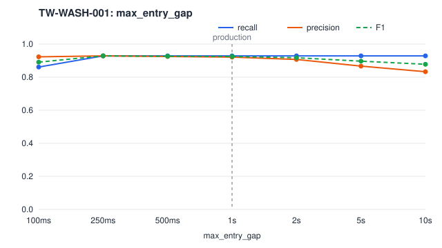
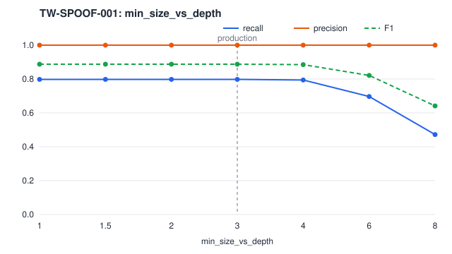
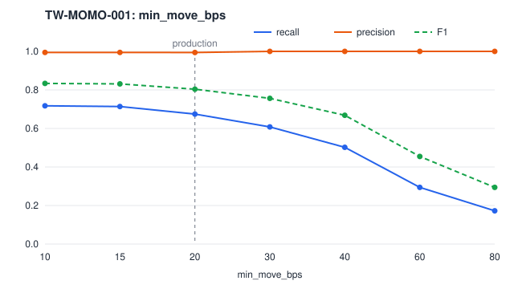
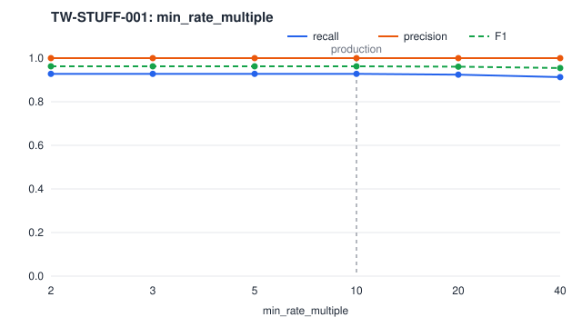
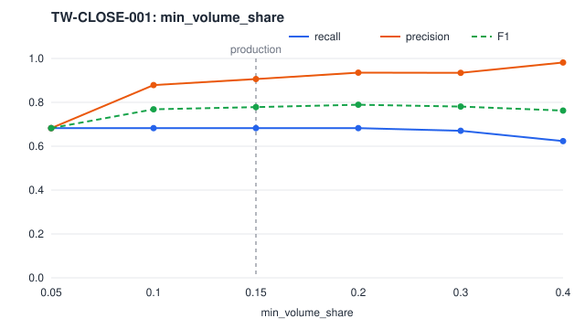

# Detection quality

Generated by `make eval` (`go run ./cmd/evaluator`). The evaluator simulates the sessions below in-process, runs every event through the ingest stage and the detection engine, exactly as the services do, and matches each rule's alerts against the simulator's ground-truth labels. Rerunning it reproduces this file.

All market data and all abuse are simulated. These numbers measure how well the detectors find the patterns TradeWatch itself injects into a synthetic market ([manipulation.md](../../manipulation.md)), not how they would perform on a real venue.

## Setup

| | |
| --- | --- |
| Sessions with injected abuse | 20 sessions of 2 h of continuous trading and a 10 min closing phase, seeds 1000–1019 |
| Sessions without abuse | 5 sessions of the same length, seeds 1020–1024 |
| Symbols | 8 per session, so 347 symbol-hours with abuse and 87 without |
| Injection | wash trading 1, spoofing 1, momentum ignition 1 and quote stuffing 1 episodes per symbol-hour; marking the close with probability 0.6 per symbol and session |
| Rules | production `rules/` (digest `e6297d9918c3`), baselines `rules/baselines/` (digest `42025ae4bdb3`) |
| Toolchain | go1.26.9 |

**Matching.** An alert matches an episode when it has the same session, symbol and abuse type, at least one account in common, was detected no earlier than the episode began, and its evidence window starts no later than one minute after the episode ended. Recall counts episodes with at least one matching alert; precision counts alerts on sessions with abuse that match an episode. Intervals are 95% Wilson score intervals. Time to detect is simulated market time from the episode's first order to the first matching alert.

## Production rules

| Abuse type | Episodes | Recall | Alerts | Precision | F1 | Time to detect (median / p90) | False alerts per 100 symbol-hours without abuse |
| --- | ---: | --- | ---: | --- | ---: | --- | ---: |
| wash_trading | 252 | 0.93 (0.89–0.95) | 254 | 0.92 (0.88–0.95) | 0.92 | 0 s / 41 s | 8.08 |
| spoofing | 267 | 0.80 (0.75–0.84) | 213 | 1.00 (0.98–1.00) | 0.89 | 12 s / 44 s | 0.00 |
| momentum_ignition | 255 | 0.67 (0.61–0.73) | 173 | 0.99 (0.97–1.00) | 0.80 | 46 s / 65 s | 0.00 |
| quote_stuffing | 264 | 0.93 (0.89–0.95) | 245 | 1.00 (0.98–1.00) | 0.96 | 0 s / 1 s | 0.00 |
| marking_the_close | 85 | 0.68 (0.58–0.77) | 64 | 0.91 (0.81–0.96) | 0.78 | 25 s / 48 s | 0.00 |

## Naive baselines

Each baseline looks only at the single most obvious signal of its abuse type, with the production rule's thresholds and suppression period where the signals overlap ([detectors.md](../../detectors.md#evaluation)).

| Abuse type | Episodes | Recall | Alerts | Precision | F1 | Time to detect (median / p90) | False alerts per 100 symbol-hours without abuse |
| --- | ---: | --- | ---: | --- | ---: | --- | ---: |
| wash_trading | 252 | 0.63 (0.57–0.69) | 1195 | 0.13 (0.11–0.15) | 0.22 | 0 s / 0 s | 319.62 |
| spoofing | 267 | 0.86 (0.81–0.90) | 21730 | 0.01 (0.01–0.01) | 0.02 | 12 s / 57 s | 6236.54 |
| momentum_ignition | 255 | 0.81 (0.76–0.85) | 476 | 0.43 (0.39–0.48) | 0.56 | 5 s / 18 s | 55.38 |
| quote_stuffing | 264 | 0.93 (0.89–0.95) | 245 | 1.00 (0.98–1.00) | 0.96 | 0 s / 1 s | 0.00 |
| marking_the_close | 85 | 0.46 (0.36–0.56) | 340 | 0.11 (0.09–0.15) | 0.18 | 101 s / 135 s | 83.08 |

## Recall by scenario

| Scenario | Abuse type | Episodes | Production recall | Baseline recall |
| --- | --- | ---: | --- | --- |
| marking_the_close | marking_the_close | 85 | 0.68 (0.58–0.77) | 0.46 (0.36–0.56) |
| momentum.ignition | momentum_ignition | 255 | 0.67 (0.61–0.73) | 0.81 (0.76–0.85) |
| quote_stuffing.burst | quote_stuffing | 264 | 0.93 (0.89–0.95) | 0.93 (0.89–0.95) |
| spoofing.layering | spoofing | 267 | 0.80 (0.75–0.84) | 0.86 (0.81–0.90) |
| wash.direct | wash_trading | 162 | 0.98 (0.95–0.99) | 0.98 (0.95–0.99) |
| wash.ring | wash_trading | 90 | 0.83 (0.74–0.90) | 0.00 (0.00–0.04) |

## Parameter sweeps

Each sweep reruns one production rule alone with one threshold changed. The production value is marked with an asterisk and a dashed line.

### TW-WASH-001: `max_entry_gap`

| max_entry_gap | Recall | Precision | F1 | False alerts per 100 symbol-hours without abuse |
| --- | --- | --- | ---: | ---: |
| 100ms | 0.86 (0.81–0.90) | 0.92 (0.88–0.95) | 0.89 | 8.08 |
| 250ms | 0.93 (0.89–0.95) | 0.93 (0.89–0.95) | 0.93 | 8.08 |
| 500ms | 0.93 (0.89–0.95) | 0.92 (0.89–0.95) | 0.93 | 8.08 |
| 1s * | 0.93 (0.89–0.95) | 0.92 (0.88–0.95) | 0.92 | 8.08 |
| 2s | 0.93 (0.89–0.95) | 0.91 (0.87–0.94) | 0.92 | 8.08 |
| 5s | 0.93 (0.89–0.95) | 0.87 (0.82–0.90) | 0.90 | 9.23 |
| 10s | 0.93 (0.89–0.95) | 0.83 (0.78–0.87) | 0.88 | 15.00 |

### TW-SPOOF-001: `min_size_vs_depth`

| min_size_vs_depth | Recall | Precision | F1 | False alerts per 100 symbol-hours without abuse |
| --- | --- | --- | ---: | ---: |
| 1 | 0.80 (0.75–0.84) | 1.00 (0.98–1.00) | 0.89 | 0.00 |
| 1.5 | 0.80 (0.75–0.84) | 1.00 (0.98–1.00) | 0.89 | 0.00 |
| 2 | 0.80 (0.75–0.84) | 1.00 (0.98–1.00) | 0.89 | 0.00 |
| 3 * | 0.80 (0.75–0.84) | 1.00 (0.98–1.00) | 0.89 | 0.00 |
| 4 | 0.79 (0.74–0.84) | 1.00 (0.98–1.00) | 0.89 | 0.00 |
| 6 | 0.70 (0.64–0.75) | 1.00 (0.98–1.00) | 0.82 | 0.00 |
| 8 | 0.47 (0.41–0.53) | 1.00 (0.97–1.00) | 0.64 | 0.00 |

### TW-MOMO-001: `min_move_bps`

| min_move_bps | Recall | Precision | F1 | False alerts per 100 symbol-hours without abuse |
| --- | --- | --- | ---: | ---: |
| 10 | 0.72 (0.66–0.77) | 0.99 (0.97–1.00) | 0.83 | 0.00 |
| 15 | 0.71 (0.66–0.77) | 0.99 (0.97–1.00) | 0.83 | 0.00 |
| 20 * | 0.67 (0.61–0.73) | 0.99 (0.97–1.00) | 0.80 | 0.00 |
| 30 | 0.61 (0.55–0.67) | 1.00 (0.98–1.00) | 0.76 | 0.00 |
| 40 | 0.50 (0.44–0.56) | 1.00 (0.97–1.00) | 0.67 | 0.00 |
| 60 | 0.29 (0.24–0.35) | 1.00 (0.95–1.00) | 0.45 | 0.00 |
| 80 | 0.17 (0.13–0.22) | 1.00 (0.92–1.00) | 0.29 | 0.00 |

### TW-STUFF-001: `min_rate_multiple`

| min_rate_multiple | Recall | Precision | F1 | False alerts per 100 symbol-hours without abuse |
| --- | --- | --- | ---: | ---: |
| 2 | 0.93 (0.89–0.95) | 1.00 (0.98–1.00) | 0.96 | 0.00 |
| 3 | 0.93 (0.89–0.95) | 1.00 (0.98–1.00) | 0.96 | 0.00 |
| 5 | 0.93 (0.89–0.95) | 1.00 (0.98–1.00) | 0.96 | 0.00 |
| 10 * | 0.93 (0.89–0.95) | 1.00 (0.98–1.00) | 0.96 | 0.00 |
| 20 | 0.92 (0.89–0.95) | 1.00 (0.98–1.00) | 0.96 | 0.00 |
| 40 | 0.91 (0.87–0.94) | 1.00 (0.98–1.00) | 0.95 | 0.00 |

### TW-CLOSE-001: `min_volume_share`

| min_volume_share | Recall | Precision | F1 | False alerts per 100 symbol-hours without abuse |
| --- | --- | --- | ---: | ---: |
| 0.05 | 0.68 (0.58–0.77) | 0.68 (0.58–0.77) | 0.68 | 5.77 |
| 0.1 | 0.68 (0.58–0.77) | 0.88 (0.78–0.94) | 0.77 | 1.15 |
| 0.15 * | 0.68 (0.58–0.77) | 0.91 (0.81–0.96) | 0.78 | 0.00 |
| 0.2 | 0.68 (0.58–0.77) | 0.94 (0.85–0.97) | 0.79 | 0.00 |
| 0.3 | 0.67 (0.57–0.76) | 0.93 (0.84–0.97) | 0.78 | 0.00 |
| 0.4 | 0.62 (0.52–0.72) | 0.98 (0.90–1.00) | 0.76 | 0.00 |
